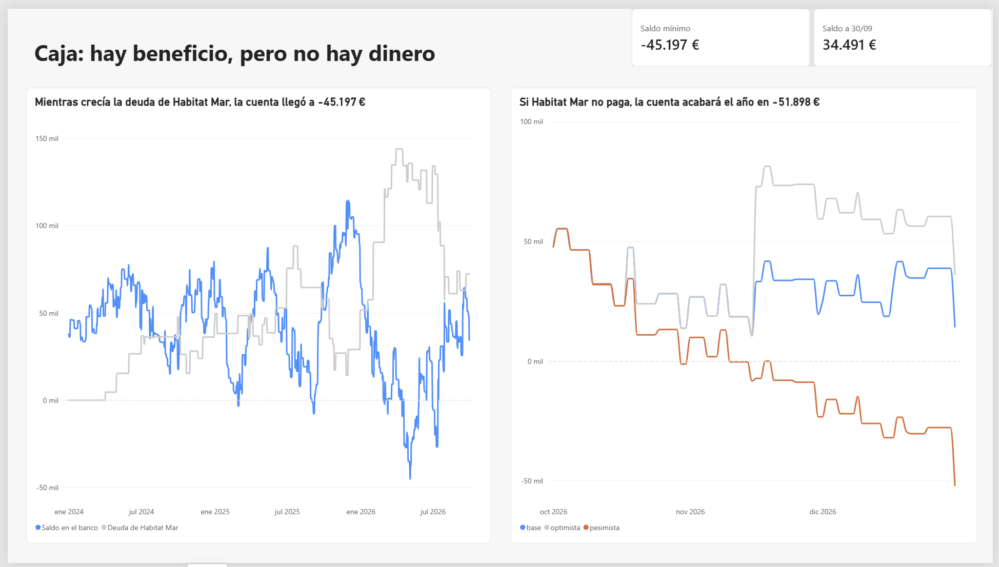

# Reformas Alzina · Rentabilidad, cobros y caja de una pyme de reformas

Caso 1 de mi portfolio de análisis de datos. Una empresa de reformas de 6 personas factura más de medio millón de euros al año, pero su gerente tiene problemas para pagar nóminas, proveedores e IVA. Este proyecto explica por qué y qué hacer.

**Resultado principal:** de enero de 2024 a septiembre de 2026 la empresa ganó 63.320 €, pero tiene 3.509 € menos en el banco. La causa es un cliente que paga a 139 días (pactó 60) y deja la mitad de margen que el resto. En mayo de 2026 la cuenta llegó a −45.197 €.

> La empresa, sus clientes y sus datos son ficticios. Los ficheros se simularon con los problemas habituales de una pyme española (dos programas de facturación, gestoría, banco).



## Preguntas de negocio

1. Desde que subieron los materiales, ¿qué trabajos y clientes dejan más margen?
2. ¿Por qué hay beneficio pero no hay dinero en la cuenta?
3. ¿Quién debe cuánto y desde cuándo?
4. ¿Qué clientes pagan tarde de forma habitual?
5. ¿Cuándo se tensa la caja y cuánto IVA hay que pagar cada trimestre?
6. ¿Se puede contratar a otro operario en 2027?

## Resultados

| Pregunta | Respuesta |
| --- | --- |
| Margen | Las cocinas han bajado del 30% al 20% de margen con la subida de materiales. Habitat Mar deja un 12% de margen frente al 29% de los particulares: 13 € por hora de operario frente a 30 €. |
| Beneficio y caja | 114.947 € de facturas sin cobrar explican la diferencia. El puente de beneficio a caja cuadra al céntimo. |
| Quién debe | 13 facturas pendientes a 30/09/2026; 92.129 € vencidos y 20.866 € probablemente impagados. |
| Quién paga tarde | Habitat Mar, 139 días de media (79 más de lo pactado). Los particulares pagan en 7. |
| Caja e IVA | La empresa adelanta IVA de facturas no cobradas: 16.929 € en el primer trimestre de 2026. Si Habitat no paga, la cuenta acaba 2026 en −51.898 €. |
| Contratar | Sí, pero después de resolver lo de Habitat: un oficial de 2ª dejaría unos 50.900 € al año por encima de su coste en obras de otros clientes. |

Las recomendaciones, con su impacto en euros, están en el informe (`informe/Caso1_Reformas_Alzina.docx`).

## Cómo está hecho

| Fase | Qué se hace | Dónde |
| --- | --- | --- |
| 1. Exploración | Primera lectura de los 7 ficheros | `python/01_exploracion.ipynb` |
| 2. Carga | Los ficheros, sin modificar, a una base de datos SQLite (tablas `bruto_*`) | `python/02_carga_sqlite.ipynb` |
| 3. Exploración en SQL | Comprobaciones de calidad con consultas | `python/03_exploracion_sql.ipynb` |
| 4. Limpieza | Tablas `limpio_*`, conciliación bancaria y estado real de cada factura | `python/04_limpieza.ipynb` |
| 5. Análisis | Margen por obra, días de cobro, puente beneficio-caja, IVA, previsión de caja y contratación | `python/05_analisis.ipynb` |
| 6. Exportación | Tablas para Power BI en CSV | `python/06_exportar_powerbi.ipynb` |
| 7. Dashboard | Modelo en estrella, medidas DAX y 3 páginas | `powerbi/dashboard_reformas_alzina.pbix` |

Los 30 problemas de calidad encontrados están documentados en `registro_limpieza.xlsx`, con las filas afectadas y la decisión tomada en cada uno.

**Puntos técnicos**

- **Conciliación bancaria en dos pasadas:** primero los cobros que citan la factura; después por importe exacto, suma de 2 a 4 facturas o facturas más antiguas del cliente. El 100% de los cobros queda asignado.
- **Margen de contribución** con el coste por hora real de cada año, sacado de las nóminas. Los materiales sin obra se reparten por presupuesto entre las obras activas.
- **Días de cobro ponderados por importe.**
- **Previsión de caja diaria** de octubre a diciembre de 2026 en tres escenarios.

## Estructura

```
datos_brutos/          7 ficheros originales de la empresa
python/                notebooks 01 a 06
sql/alzina.db          base de datos SQLite (bruto, limpio y análisis)
powerbi/               dashboard (.pbix), capturas y datos exportados
informe/               definición del proyecto, informe final y gráficos
registro_limpieza.xlsx registro de problemas de calidad
```

## Cómo ejecutarlo

Requisitos: Python 3.10 o superior con `pandas`, `openpyxl` y `matplotlib`.

```
pip install pandas openpyxl matplotlib
```

Ejecuta los notebooks en orden, de `02` a `06`. Cada uno lee la base de datos que deja el anterior, así que todo se puede reconstruir desde los ficheros originales. Si un notebook no encuentra la base de datos, cambia la variable `PROYECTO` del principio por la ruta de la carpeta en tu ordenador.

## Herramientas

Python (pandas, matplotlib) · SQL (SQLite) · Power BI (DAX) · Excel
